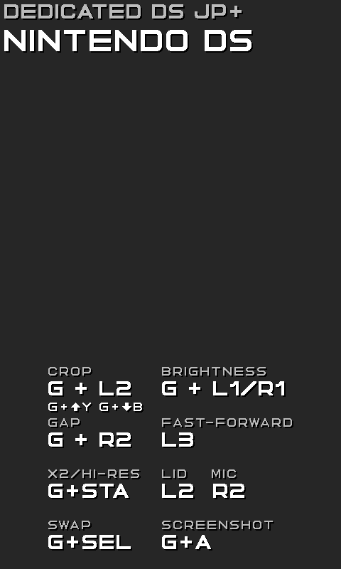

[English](README.md) | 日本語

# DEDICATED OS JP+ (`dedicated-zero40-jp-plus`)

MagicX Zero40向けニンテンドーDS専用ランチャー [DEDICATED OS](https://github.com) の非公式カスタム版（フォーク）です。

オリジナルの持つ「シンプルで迷わない操作感」や「ピクセルパーフェクトな整数スケーリング」を尊重しつつ、日本語ROM名の表示、上下画面の個別クロップ、タイトルごとの画面スワップ、Hi-Res 3Dの切り替え、スクリーンショット保存機能を追加しています。

> **ピクセルパーフェクト表示の仕組み**
> 
> ニンテンドーDSの横幅（`256px`）を**2倍（`512px`）**に拡大すると、MagicX Zero 40の画面横幅（`480px`）に対して合計 `32px` だけはみ出します。
> 
> dedicatedOSでは、画面枠に無理やり収めるために中途半端な倍率へ縮小するのではなく、**はみ出す横幅（左右16pxずつ）をあえてクロップ（切り落とし）**しています。
> 
> 端を切り落としてでも**端数の出ない2倍（整数スケーリング）**を優先する設計により、文字やドット絵が一切にじまない、くっきりとした表示を実現しています。

最新版は [Releasesページ](../../releases) からダウンロードできます。

## 追加された主な機能

- **日本語ROM名の表示・自然順ソート:** `SDL2_ttf` と `NotoSansJP-Bold.ttf`（`font.ttf`）を使用し、日本語を含むゲームタイトルを正しく表示します。ゲーム一覧はひらがな・カタカナを同一視した自然順で並びます。
- **上下独立の画面クロップ（拡大表示）:** 上画面のみ・下画面のみのオーバースキャンクロップを個別に切り替えられます。これにより上画面だけクロップしてピクセルパーフェクト表示、下画面はステータスやテキスト情報が見切れないよう元の表示にするといった使い方ができます。
- **Hi-Res 3D（高解像度3D）の切り替え:** ゲーム中からDraSticの3D高解像度設定（`hires_3d`）のON/OFFを切り替えられます。切り替え後は自動でセーブ＆再起動してレジュームします。
  - **※注意点:** 現状、Hi-Res 3DをONにするとソフトウェアレンダリングで動作するため、処理負荷の重いゲームでは動作が不安定になる場合があります。
- **タイトルごとの上下画面スワップ:** プレイ中に上下画面の位置を入れ替えられます。設定はゲームタイトルごとに自動保存されます。
  - **※補足:** Hi-Res 3DをONにした際、一部タイトル（『ファイナルファンタジーIII』『ドラゴンクエストIV』など）で上下画面が逆転します。（drasticのバグ起因）そういった事象が発生した際には手動で切り替えてください。
- **スクリーンショット保存:** 上下画面を結合したBMP画像を `/mnt/SDCARD/userdata/screenshots/` に保存します。

## ショートカットキー一覧

`G` は本体中央の `MENU` / `HOME` / `BACK` ボタンを指します。

| 操作 | ショートカット | 備考 |
| :--- | :--- | :--- |
| **上下まとめてクロップ切替** | `G + L2` | 両画面のオーバースキャンクロップを一括切替 |
| **上画面のみクロップ切替** | `G + ↑` または `G + Y` | 上画面のみのクロップを個別切替 |
| **下画面のみクロップ切替** | `G + ↓` または `G + B` | 下画面のみのクロップを個別切替 |
| **画面間の隙間（Gap）切替** | `G + R2` | 上下画面の間の隙間の有無を切替 |
| **上下画面の入れ替え（Swap）** | `G + SELECT` | 上下画面を反転（ゲームタイトルごとに保存） |
| **Hi-Res 3D 切替** | `G + START` | 高解像度3Dを切替（自動で保存・再起動します） |
| **画面の明るさ調整** | `G + L1 / R1` | バックライト輝度の調整 |
| **早送り（Fast-Forward）** | `L3` | 早送りのON/OFF切替 |
| **疑似スリープ（蓋閉じ）/ マイク** | `L2` / `R2` | DSの蓋を閉じる操作 / マイク入力のシミュレート |
| **スクリーンショット撮影** | `G + A` | `userdata/screenshots/` にBMP形式で保存 |

## 導入手順（新規インストール）

MagicX Zero40は2枚のSDカードを使用します。**SD1（システム起動用）はオリジナル版と全く同じもの**を使用し、**SD2（データ・ランチャー用）に本プロジェクトのファイル**を配置します。

### 1. SD1（本体上部 TF1/INT スロット用）の準備
1. オリジナル作者が配布している専用の軽量ベースイメージ（`main-zero40`）を [本家Releasesページ](https://github.com/releases)（または関連リポジトリ）からダウンロードします。
2. Rufus や BalenaEtcher などの書き込みツールを使い、小容量のSDカードにイメージを書き込みます。
3. 本体の **上部（TF1/INT）スロット** に挿入します。

### 2. SD2（本体下部 TF2/EXT スロット用）の準備
1. ゲーム保存用のSDカードを **FAT32（パーティション形式は GPT ではなく MBR）** でフォーマットします。
2. 本リポジトリの [Releasesページ](../../releases) から最新の `dedicated-zero40-jp-plus` のzipファイルをダウンロードして解凍します。
3. 解凍した中身の **すべてのファイルとフォルダ** を、フォーマットしたSDカードのルート（一番上の階層）にそのままコピーします。
（DraSticの初期設定なども最適化済みの状態で含まれています）
4. SDカード内の `/games/` フォルダにNDSのROMファイルやBIOSファイルを配置します。ファイル名は日本語に対応しています。
（今すぐ遊ばないゲームは `/games/archive` に入れるとメニューから隠せます）
5. 本体の **下部（TF2/EXT）スロット** に挿入し、電源を入れます。

## アップデート手順（既存環境からの更新）

すでに本家 DEDICATED OS、または旧バージョンの JP+ を導入済みの場合は、以下の手順だけで更新できます。

1. 本リポジトリの [Releasesページ](../../releases) から最新のzipファイルをダウンロードして解凍します。
2. 解凍した中にある **`system.zip`** と **`bootlogo.bmp`** の2つを、SD2（TF2/EXT）のルート（一番上の階層）に配置（上書きコピー）します。
   ※ `system.zip` だけを差し替えると、起動画面の操作ガイド画像（`bootlogo.bmp`）が更新されないため、必ず両方コピーしてください。
3. SDカードを本体に戻して起動します。
4. **初回起動時に `system.zip` が自動的に展開されてシステムが更新され、完了後に `system.zip` 自体は自動削除されます。**

## フォントのカスタマイズ

- **フォントの変更:** 配布パッケージには `NotoSansJP-Bold.ttf` が含まれており、実機では `/mnt/SDCARD/system/assets/font.ttf`（ライセンス表記の `OFL.txt` とセット）として配置されます。お好みのTrueTypeフォントを `font.ttf` にリネームして差し替えることも可能です。フォントが見つからない場合は内蔵ビットマップフォントで表示されます。

## クレジット・ライセンス

- オリジナル版 **DEDICATED OS**: [shauninman / dedicated-os](https://github.com)
- 同梱日本語フォント **Noto Sans JP**: SIL Open Font License 1.1（`OFL.txt`）に基づき同梱しています。
- プロジェクト全体のライセンスについては [LICENSE.md](LICENSE.md) をご覧ください。

