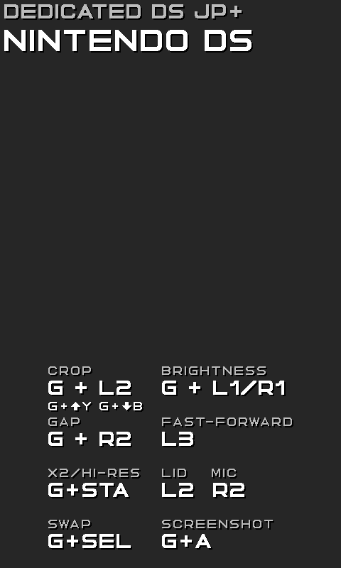
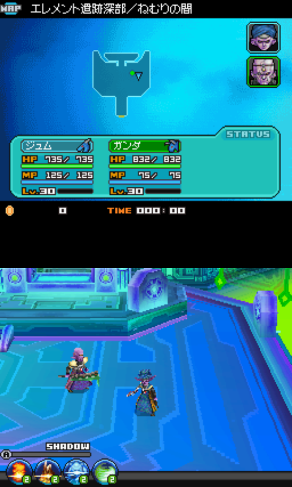
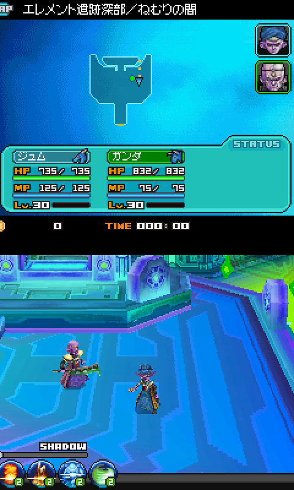
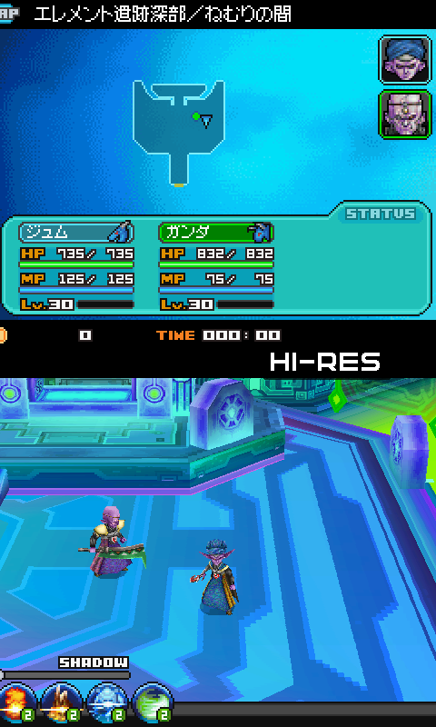

English | [日本語](README.ja.md)

# DEDICATED OS JP+ (`dedicated-zero40-jp-plus`)

An unofficial, custom fork of [DEDICATED OS](https://github.com/dedicated-os/dedicated-zero40) for playing Nintendo DS on the MagicX Zero40.

This build preserves the core minimalist experience of the original DEDICATED OS while adding Japanese ROM name rendering, independent per-screen cropping, per-title screen swapping, Hi-Res 3D toggling, and a screenshot shortcut.

You can [grab the latest release here](../../releases).

## Added Features

- **Japanese ROM Names:** Renders UTF-8 / Japanese game titles using `SDL2_ttf` and `NotoSansJP-Bold.ttf` (`font.ttf`), with natural sorting (combining Hiragana and Katakana).
- **Independent Screen Crop:** Toggle integer scaling / overscan cropping individually for the top or bottom screen.
- **Per-Title Screen Swap:** Swap the top and bottom screens on the fly. The state is saved per game title.
- **Hi-Res 3D Toggle:** Switch DraStic's high-resolution 3D rendering (`hires_3d`) on or off directly from in-game. Automatically restarts and resumes your session.
- **Screenshot Capture:** Save combined dual-screen screenshots directly to `/mnt/SDCARD/userdata/screenshots/`.

## Shortcuts

`G` refers to the `MENU` / `HOME` / `BACK` button.

| Action | Shortcut | Notes |
| :--- | :--- | :--- |
| **Crop (Both Screens)** | `G + L2` | Toggles overscan crop for both screens |
| **Crop (Top Screen)** | `G + Up` or `G + Y` | Toggles crop for the top screen only |
| **Crop (Bottom Screen)** | `G + Down` or `G + B` | Toggles crop for the bottom screen only |
| **Screen Gap** | `G + R2` | Toggles the gap between top and bottom screens |
| **Screen Swap** | `G + SELECT` | Swaps top/bottom screens (saved per title) |
| **Hi-Res 3D** | `G + START` | Toggles Hi-Res 3D and auto-restarts the game |
| **Brightness** | `G + L1 / R1` | Adjusts screen brightness |
| **Fast-Forward** | `L3` | Toggles fast-forward |
| **Faux Lid / Mic** | `L2` / `R2` | Simulates closing the DS lid / blowing into the mic |
| **Screenshot** | `G + A` | Saves a `.bmp` image to `userdata/screenshots/` |

## Installation & Updating

### Fresh Installation

1. Follow the official installation guide on [dedicated-os/dedicated-zero40](https://github.com/dedicated-os/dedicated-zero40/releases) to flash `main-zero40` (TF1/INT) and set up your FAT32 SD card (TF2/EXT).
2. Download the latest `dedicated-zero40-jp-plus` zip from the [Releases](../../releases) page, unzip it, and copy its contents (`system.zip`, `bootlogo.bmp`, etc.) to the root of your TF2/EXT SD card, overwriting if prompted.
3. Add your NDS games and BIOS files to `/games/`, then insert the card into the bottom TF2/EXT slot.

### Updating from Original DEDICATED OS (or an older JP+ release)

1. Ensure you already have the official [DEDICATED OS](https://github.com/dedicated-os/dedicated-zero40/releases) installed and working on your TF2/EXT SD card.
2. Download the latest `dedicated-zero40-jp-plus` zip from the [Releases](../../releases) page and unzip it.
3. Copy both `system.zip` and `bootlogo.bmp` to the root of your TF2/EXT SD card, overwriting the existing files.
   *(Note: Replacing only `system.zip` will not update the boot logo shortcut guide.)*
4. Eject the SD card safely, insert it into the bottom TF2/EXT slot, and boot your device.

## Fonts

- **Custom Fonts:** The release includes `NotoSansJP-Bold.ttf` (installed as `/mnt/SDCARD/system/assets/font.ttf` along with `OFL.txt`). You can replace `font.ttf` with any TrueType font of your choice. If missing, the launcher falls back to its built-in bitmap font.

## Credits & License

- Original **DEDICATED OS** by [shauninman / dedicated-os](https://github.com/dedicated-os/dedicated-zero40).
- Bundled Japanese font **Noto Sans JP** licensed under the SIL Open Font License 1.1 (`OFL.txt`).
- See [LICENSE.md](LICENSE.md) for project license details.
